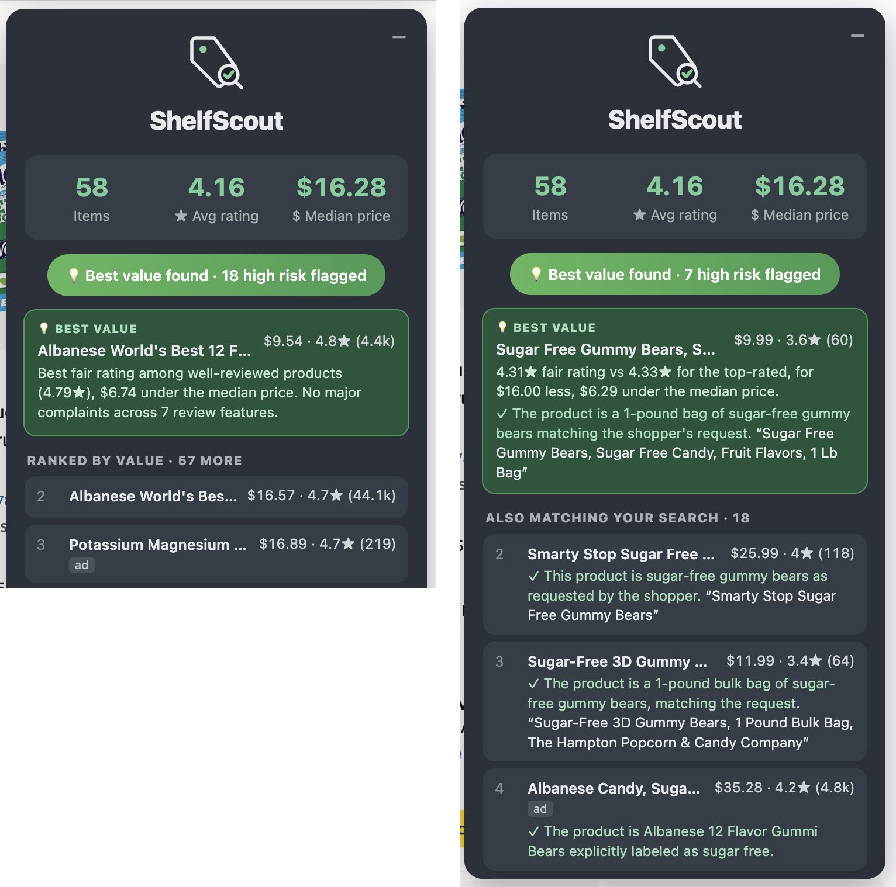
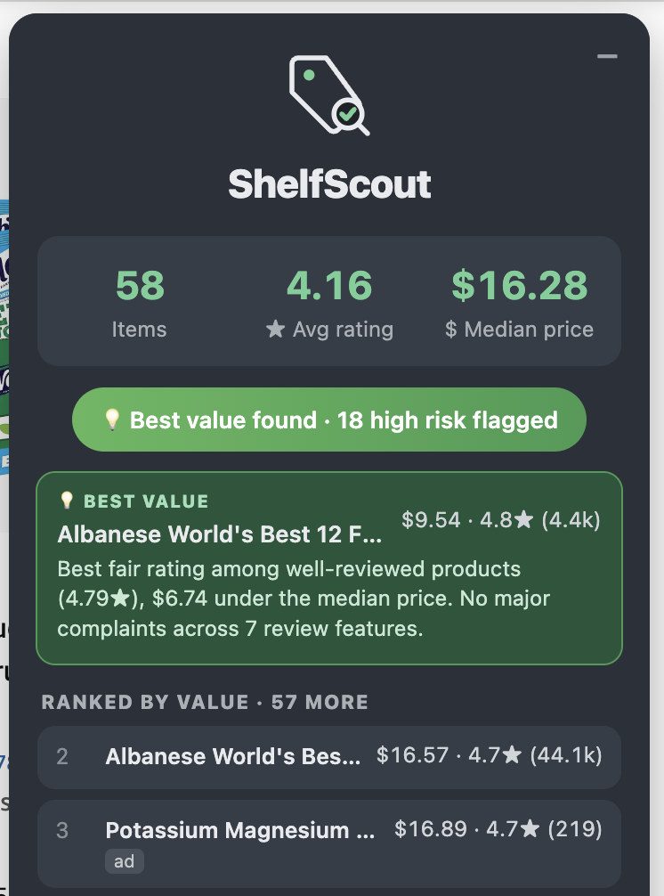
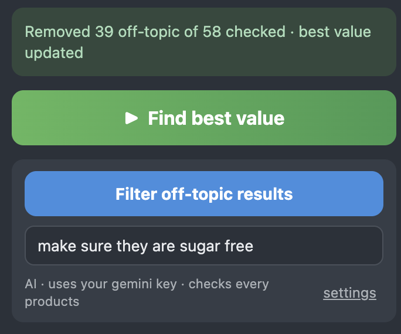
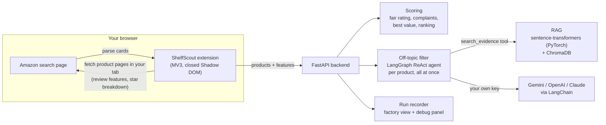
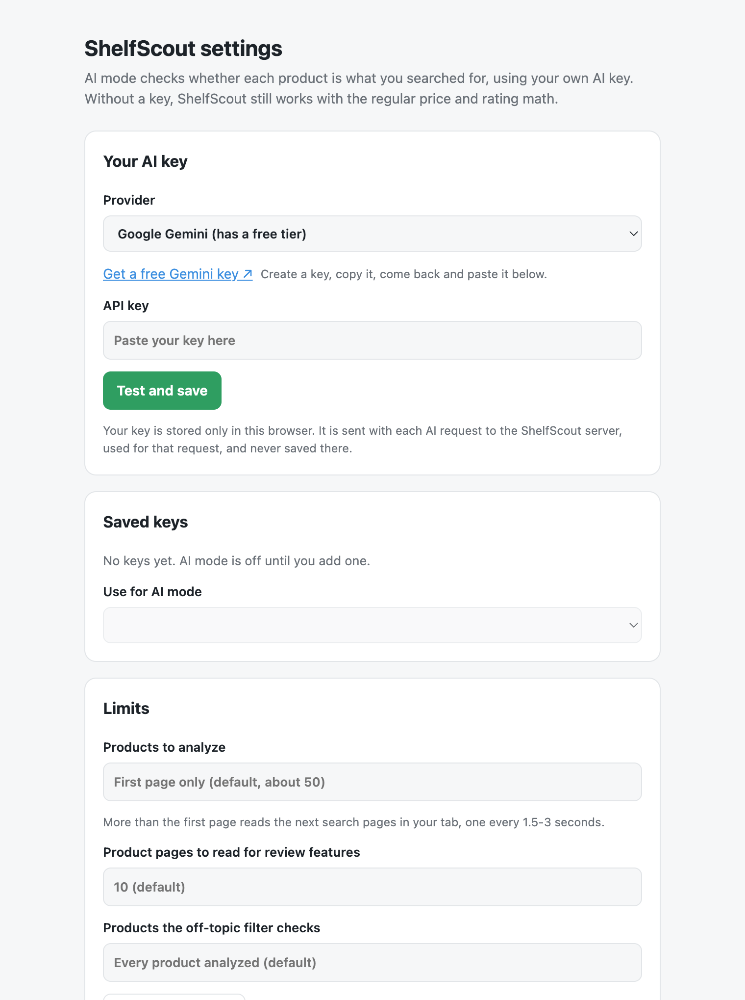

# ShelfScout

**Find the best value on any Amazon search: not just the cheapest or the most promoted, and actually what you searched for.**

A Chrome extension with a Python backend. One click ranks every product on the page by value. A second click
has an AI agent remove what you didn't ask for.



*Searching "sugar free gummy bears": the math alone picks **regular** gummy bears (left). One click on
"Filter off-topic results" checks all 58 products, removes the 39 that aren't sugar-free gummy bears, and the best value
becomes an actual sugar-free bag (right).*

## How it works

**1. Find best value (instant, no AI)**
ShelfScout reads the products already on the page and scores them with plain math:

- **Fair rating.** A 4.8★ product with 12 ratings shouldn't beat a 4.4★ product with 18,000, so small rating
  counts are pulled toward the page average. That's why a 3.6★ product with few ratings can still have a solid
  fair rating, and why a 5.0★ product with 3 ratings doesn't win.
- **Review complaints.** For the top products it reads Amazon's per-feature review counts
  ("durability: 45 mentions, 40% negative"). A feature with 10+ mentions and 30%+ negative is a **major complaint**.
- **Best value** = the cheapest product within 0.15★ (fair rating) of the best, among products with 50+ ratings
  and no major complaint.
- Everything else gets **one ranked list**, with **HIGH RISK** tags (a major complaint, or too few ratings to
  trust) and **ad** tags.



**2. Filter off-topic results (AI, optional)**
The math can't tell that regular gummy bears aren't sugar-free. The filter can. Click **Filter off-topic results**
and add instructions if you like ("make sure they are sugar free", "no plastic, for a large dog").
An AI agent checks each product against your search. Off-topic products drop out, the best value is recalculated,
and every match shows a one-line reason, plus a supporting quote from the listing or a customer review when one is
found. (On the gummy bear search: 19 of 58 kept, 24 quotes cited, all 24 verified as real.)

 

**Export:** Excel (Summary dashboard, Shortlist, every product ranked), CSV or JSON.

## System design



| Part | Tech | Job |
|---|---|---|
| Extension | Chrome MV3, plain JS | Reads the page, fetches product pages in your tab, shows the panel, exports |
| Backend | FastAPI (async) | Scoring, the AI filter, Excel export, run recording |
| Agent | LangGraph ReAct agent (LangChain `create_agent`, which compiles to a LangGraph graph) | One per product: decides when to look up evidence (it's told to when the title doesn't settle it), returns relevant / not + reason + optional quote |
| RAG | sentence-transformers embeddings (PyTorch, inference only) + ChromaDB | Searches a product's title, Amazon review-feature summaries and customer quotes by meaning ("no mess" finds "peeled off clean"). The vector store is in memory, built fresh for each request |
| LLM | Gemini, OpenAI or Claude via LangChain | Bring your own key; the model is picked automatically from what the key can use |
| Guardrails | code | Every cited quote is checked word for word against the evidence (invented quotes are dropped); agents that loop get one "decide now" fallback; a shared AIMD rate limiter backs off when the provider complains |
| Observability | run recorder | Every request is saved stage by stage (items in/out, timing, flags); open it in the factory view or the extension's **Debug** panel |

### Benchmark: latency

The off-topic filter run two ways, one at a time vs all at once, on the same products with `gemini-3.8-flash`:
29 saved Amazon searches × 5 products each = 145 checks each mode.



| Mode | Wall time | Per check p50 / p95 | Throughput | Errors |
|---|---|---|---|---|
| One at a time | 1,156 s (19 min) | 5.4 s / 20.4 s | 0.13 / s | 0 |
| All at once | **72 s** | 6.9 s / 22.7 s | 2.02 / s | 0 |

**16.1× faster.** Each check gets somewhat slower under load (median 6.9 s vs 5.4 s), but running them all at once
more than makes up for it. No rate-limit backoffs. Other numbers from the same run:

- **Consistency:** 141 of 145 products (97%) got the same verdict in both modes.
- **Fallbacks:** 4 of 290 checks (1.4%) needed the "decide now" fallback after the agent looped without answering.
- **Errors:** 0 of 290.

Full results: [`benchmarks/latency-20261121-182221-8664.json`](benchmarks/latency-20261121-182221-8664.json).
The frozen searches are in `data/bench/`, so you can rerun it with your own key:
`GEMINI_API_KEY=... uv run python -m shelfscout.latency --per-search 5`
(about 20 minutes; it rewrites the results file and the bar race). To refreeze the searches from Amazon:
`uv run python -m shelfscout.bench --redo`.

## Permissions

| Permission | Why |
|---|---|
| `https://www.amazon.com/*` | Show the panel on search pages and read product pages for review features, in your tab, one every 1.5-3 s |
| `http://localhost:8100/*` | Talk to the ShelfScout backend running on your machine |
| `storage` | Your AI key, limits and cached review features (24 h), in this browser only |
| `scripting` | Re-attach the panel to an Amazon tab that was open before the extension loaded |

The panel never appears on cart, checkout, sign-in or account pages.

## Run it

You need Python 3.11+, [uv](https://docs.astral.sh/uv/) and Chrome.

1. **Get the code:**
   ```bash
   git clone https://github.com/bradyuan/shelfscout && cd shelfscout
   uv sync
   pwd   # the extension is in this folder's extension/ subfolder
   ```
2. **Load the extension:** open `chrome://extensions`, turn on **Developer mode**, click **Load unpacked** and pick
   the `extension` folder. (On a Mac, Cmd+Shift+G in the file picker lets you paste the path `pwd` printed, plus
   `/extension`.)
3. **Start the backend**, and leave this terminal open while you use ShelfScout:
   ```bash
   uv run uvicorn shelfscout.api:app --port 8100
   ```
4. **Use it:** search Amazon for anything. Click the green **ShelfScout** pill, then **Find best value**.
5. *(Optional, for the AI filter)* Open settings: right-click the ShelfScout toolbar icon → **Options** (or the
   **settings** link under the filter button after a run). Pick a provider and paste a key. Gemini has a free tier:
   **Get a free Gemini key** opens Google AI Studio. The key is tested when you paste it. The first filter run
   downloads the small embedding model (about 90 MB) from Hugging Face.



**Limits** (settings): products to analyze (default: the first page; higher reads the next pages),
product pages read for review features (default 10), products the filter checks (default: all).

**Developer views:** `http://localhost:8100/runs` lists every run. Click one to see each stage's rows.
Run the tests with `uv run pytest`.

## Privacy

- **No Amazon account data.** ShelfScout reads only what's on the page: product titles, prices, ratings and
  Amazon's public review summaries. It never reads your orders, address, cart or login.
- **Product data goes to the backend on your machine** (`localhost`), not to a third party.
- **Your AI key stays in your browser.** It's sent with each filter request, used for that request and never
  saved on the server or written to logs.
- **The AI filter sends product text to the provider you chose** (Google, OpenAI or Anthropic), under your key and
  their terms. Without a key, nothing leaves your machine except the normal Amazon page loads.
- No analytics, no tracking, no accounts.

## Limitations

- Amazon.com (US) only, and parsers break when Amazon changes its page layout.
- Review features come from Amazon's own AI summaries of reviews; products with few reviews have none.
- The off-topic filter judges from the title, review features and quotes. A listing that hides what it is can
  still slip through.
- Relevance accuracy hasn't been measured yet; latency and consistency have.

## Project layout

```
extension/          Chrome extension: panel (content.js), parsers, settings page, background relay
shelfscout/api.py   FastAPI endpoints: analyze, AI filter, export
shelfscout/value.py scoring: fair rating, complaints, best value, ranking
shelfscout/ai.py    off-topic filter: LangGraph agent, RAG, model picking, rate limiter, quote check
shelfscout/export.py Excel export
shelfscout/latency.py latency benchmark (CLI): writes benchmarks/*.json and docs/latency-race.svg
shelfscout/bench.py freezes Amazon searches with Selenium for repeatable benchmarks
shelfscout/factory.py, trace.py  run recorder and factory view
tests/              pytest (plumbing, with fake models)
benchmarks/         saved benchmark results
data/bench/         the frozen Amazon searches the benchmark runs on
```
