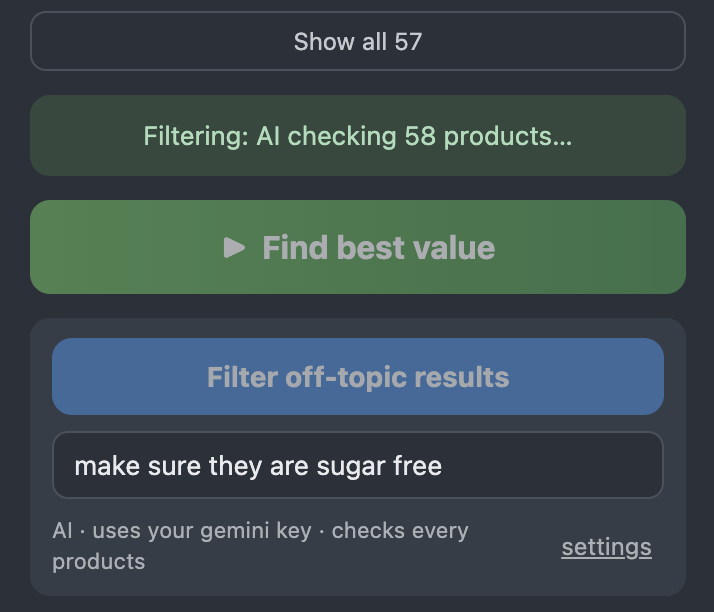
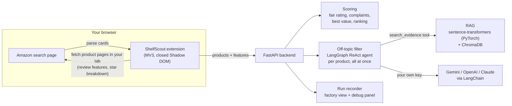

# ShelfScout

**Find the best value on any Amazon search: not the cheapest, not the sponsored pick, and actually what you searched for.**

A Chrome extension with a Python backend. One click ranks every product on the page by value. A second click
has an AI agent remove what you didn't ask for.


*Searching "sugar free gummy bears": the math alone picks **regular** gummy bears (left). One click on
"Filter off-topic results" removes 39 of 58 off-topic products, and the best value becomes an actual sugar-free bag (right).*

## How it works

**1. Find best value (instant, no AI)**
ShelfScout reads the products already on the page and scores them with plain math:

- **Fair rating.** A 4.8★ product with 12 ratings shouldn't beat a 4.4★ product with 18,000, so small rating
  counts are pulled toward the page average. That's why a 3.6★ product with few ratings can still have a solid
  fair rating, and why a 5.0★ product with 3 ratings doesn't win.
- **Review complaints.** For the top products it reads Amazon's per-feature review counts
  ("durability: 45 mentions, 40% negative"). A feature with 10+ mentions and 30%+ negative is a **major complaint**.
- **Best value** = the cheapest product within 0.15★ (fair rating) of the best, among products with 50+ ratings
  and no major complaint.
- Everything else gets **one ranked list**, with **HIGH RISK** tags (a major complaint, or too few ratings to
  trust) and **ad** tags.


**2. Filter off-topic results (AI, optional)**
The math can't tell that regular gummy bears aren't sugar-free. The filter can. Click **Filter off-topic results**
and add instructions if you like ("make sure they are sugar free", "no plastic, for a large dog").
An AI agent checks each product against your search. Off-topic products drop out, the best value is recalculated,
and every match shows its reason, quoting the listing or a customer review.

 

**Export:** Excel (Summary dashboard, Shortlist, every product ranked), CSV or JSON.

## System design



| Part | Tech | Job |
|---|---|---|
| Extension | Chrome MV3, plain JS | Reads the page, fetches product pages in your tab, shows the panel, exports |
| Backend | FastAPI (async) | Scoring, the AI filter, Excel export, run recording |
| Agent | LangGraph ReAct agent (LangChain `create_agent`) | One per product: looks up evidence only when the title doesn't settle it, returns relevant / not + reason + quote |
| RAG | sentence-transformers on PyTorch + ChromaDB | Searches a product's title, Amazon review-feature summaries and customer quotes by meaning ("no mess" finds "peeled off clean") |
| LLM | Gemini, OpenAI or Claude via LangChain | Bring your own key; the model is picked automatically from what the key can use |
| Guardrails | code | Every cited quote is checked word for word against the evidence (invented quotes are dropped); agents that loop get one "decide now" fallback; a shared AIMD rate limiter backs off when the provider complains |
| Observability | run recorder | Every request is saved stage by stage (items in/out, timing, flags); open it in the factory view or the extension's **Debug** panel |

### Benchmark: latency

The off-topic filter on 150 products (30 saved searches × 5), `gemini-3.8-flash`:

| Mode | Wall time | Per check p50 / p95 | Throughput | Errors |
|---|---|---|---|---|
| One at a time | 1,276 s (21 min) | 6.3 s / 23.2 s | 0.12 / s | 0 |
| All at once | **46 s** | 5.9 s / 20.0 s | 3.24 / s | 0 |

**27.6× faster**, with no slowdown per check and no rate-limit backoffs. Across the two runs, 98% of products got
the same verdict. Rerun it with `GEMINI_API_KEY=... uv run python -m shelfscout.latency`.

## Permissions

| Permission | Why |
|---|---|
| `https://www.amazon.com/*` | Show the panel on search pages and read product pages for review features, in your tab, one every 1.5-3 s |
| `http://localhost:8100/*` | Talk to the ShelfScout backend running on your machine |
| `storage` | Your AI key, limits and cached review features (24 h), in this browser only |
| `scripting` | Re-attach the panel to an Amazon tab that was open before the extension loaded |

The panel never appears on cart, checkout, sign-in or account pages.

## Run it

You need Python 3.11+, [uv](https://docs.astral.sh/uv/) and Chrome.

```bash
git clone https://github.com/bradyuan/shelfscout && cd shelfscout
uv sync
uv run uvicorn shelfscout.api:app --port 8100
```

1. Open `chrome://extensions`, turn on **Developer mode**, click **Load unpacked** and pick the `extension/` folder.
2. Search Amazon for anything. Click the green **ShelfScout** pill, then **Find best value**.
3. *(Optional, for the AI filter)* Open the panel's **settings**, pick a provider and paste a key.
   Gemini has a free tier: **Get a free Gemini key** opens Google AI Studio. The key is tested when you paste it.


**Limits** (settings): products to analyze (default: the first page; higher reads the next pages),
product pages read for review features (default 10), products the filter checks (default: all).

**Developer views:** `http://localhost:8100/runs` lists every run. Click one to see each stage's rows.
Run the tests with `uv run pytest`.

## Privacy

- **No Amazon account data.** ShelfScout reads only what's on the page: product titles, prices, ratings and
  Amazon's public review summaries. It never reads your orders, address, cart or login.
- **Product data goes to the backend on your machine** (`localhost`), not to a third party.
- **Your AI key stays in your browser.** It's sent with each filter request, used for that request and never
  saved on the server or written to logs.
- **The AI filter sends product text to the provider you chose** (Google, OpenAI or Anthropic), under your key and
  their terms. Without a key, nothing leaves your machine except the normal Amazon page loads.
- No analytics, no tracking, no accounts.

## Limitations

- Amazon.com (US) only, and parsers break when Amazon changes its page layout.
- Review features come from Amazon's own AI summaries of reviews; products with few reviews have none.
- The off-topic filter judges from the title, review features and quotes. A listing that hides what it is can
  still slip through.
- Relevance accuracy hasn't been measured yet; latency and consistency have.

## Project layout

```
extension/          Chrome extension: panel (content.js), parsers, settings page, background relay
shelfscout/api.py   FastAPI endpoints: analyze, AI filter, export
shelfscout/value.py scoring: fair rating, complaints, best value, ranking
shelfscout/ai.py    off-topic filter: LangGraph agent, RAG, model picking, rate limiter, quote check
shelfscout/export.py Excel export
shelfscout/latency.py latency benchmark (CLI)
shelfscout/bench.py freezes Amazon searches with Selenium for repeatable benchmarks
shelfscout/factory.py, trace.py  run recorder and factory view
tests/              pytest (plumbing, with fake models)
```
